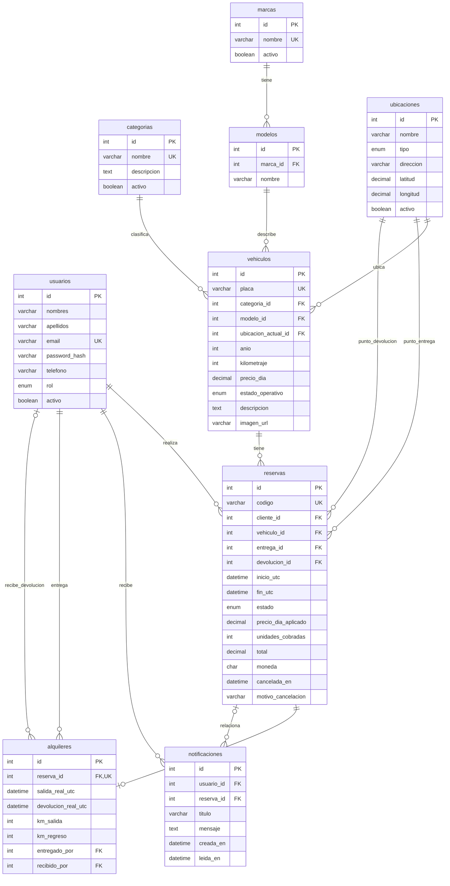

# Modelo de datos de AutoRent

El modelo utiliza nueve tablas InnoDB en MySQL 8.4. Las claves primarias son identificadores enteros sin signo. Las claves foráneas conservan el mismo tipo y restringen la eliminación de datos que tienen referencias históricas.

## Tablas y relaciones

| Tabla | Responsabilidad |
| --- | --- |
| `usuarios` | Identidad, datos de contacto, hash y rol del usuario. Un cliente es un usuario con rol `cliente`. |
| `categorias` | Agrupaciones como sedán, SUV y pickup. |
| `marcas` | Marcas de los modelos del catálogo. |
| `modelos` | Cada modelo pertenece a una marca; su nombre es único dentro de esa marca. |
| `ubicaciones` | Sucursales y puntos autorizados de entrega/devolución con coordenadas. |
| `vehiculos` | Unidades identificadas por placa, categoría, modelo, ubicación y estado operativo. |
| `reservas` | Cliente, vehículo, período, ubicaciones acordadas y tarifa histórica. |
| `alquileres` | Datos reales de entrega y devolución de una reserva. |
| `notificaciones` | Avisos destinados a un usuario y, opcionalmente, relacionados con una reserva. |

La marca del vehículo se obtiene por su modelo; no se duplica en `vehiculos`. El historial se consulta desde reservas y alquileres. Una reserva que todavía no se ha entregado no tiene alquiler asociado.

## Diagrama entidad relación

El diagrama muestra las claves y los campos principales. La definición completa, incluidos todos los campos y restricciones, se encuentra en `database/migrations/001_initial_schema.sql`.

Las dos relaciones entre ubicaciones y reservas corresponden a claves diferentes: `entrega_id` y `devolucion_id`. Lo mismo ocurre con `entregado_por` y `recibido_por` en alquileres. `recibido_por` es nulo mientras el alquiler siga abierto; `notificaciones.reserva_id` puede ser nulo para un aviso general.

## Tipos de datos

| Dato | Tipo y criterio |
| --- | --- |
| Identificadores y kilometrajes | Enteros sin signo. |
| Tarifa por día | `DECIMAL(10,2)`. |
| Total | `DECIMAL(12,2)`, igual a tarifa aplicada por bloques cobrados. |
| Fechas | `DATETIME(6)`, bajo convención UTC en cada conexión. |
| Coordenadas | `DECIMAL(10,7)`, con límites de latitud y longitud. |
| Contraseña | Hash almacenado en `VARCHAR(255)`; bcrypt se aplicará en la API. |
| Roles y estados | `ENUM` para los valores iniciales del MVP. |

Los valores exactos de estado y todas las columnas opcionales se consultan en el script. `ubicaciones.tipo` permite `sucursal` y `punto_autorizado`.

## Restricciones de integridad

- Correo, placa, código de reserva, categoría y marca no pueden repetirse. El nombre de un modelo es único por marca.
- El fin de una reserva debe ser posterior al inicio. Las tarifas no pueden ser negativas y cada reserva tiene al menos una unidad cobrada.
- Una reserva cancelada requiere su fecha de cancelación; los demás estados no admiten datos de cancelación.
- Una reserva puede tener como máximo un alquiler. La fecha de devolución, el kilometraje final y el administrador que recibe se registran juntos.
- Una devolución no puede preceder a la salida ni reducir el kilometraje. Una notificación no puede figurar como leída antes de ser creada.

Los índices de reservas favorecen las consultas por vehículo, estado y período, y el historial por cliente. Los índices de notificaciones ayudan a consultar los avisos de cada usuario y su lectura.

## Validaciones de la futura API

Las claves foráneas verifican la existencia de las referencias. Los servicios deberán comprobar además roles, permisos, transiciones de estado, disponibilidad y que el número de bloques corresponda a la duración solicitada. El script de comprobaciones puede detectar algunas inconsistencias, pero esa consulta no impide que se escriban.

Los intervalos de dos filas no se comparan mediante una restricción `CHECK`. La protección de reservas concurrentes se implementará mediante transacciones y bloqueo del vehículo, como se describe en `docs/business-rules.md`.

## Uso del catálogo de demostración

El catálogo inicial sirve para probar filtros, relaciones, precios y estados. Contiene tres categorías, tres marcas, seis modelos, dos ubicaciones y seis vehículos. No contiene datos reales de clientes ni información validada de la empresa propuesta. Cada script de carga se aplica una sola vez para que los datos duplicados produzcan un error visible.
